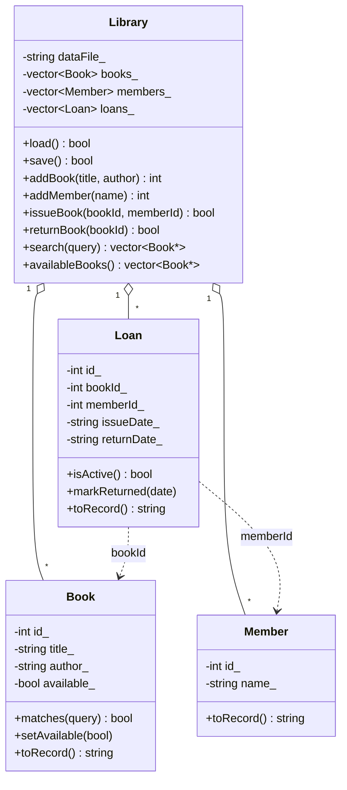

# Object-Oriented Library Manager

A menu-driven C++17 console application that models a small library using classes, encapsulation, collections and file persistence.

## Features

- Add books and members
- Issue and return books (one active loan per book, maximum 3 active loans per member)
- Search by title or author (case-insensitive)
- List available books, all books, members and active loans
- Records are saved to a local CSV file after every change and reloaded on startup

## Project Structure

```
library-manager/
├── src/
│   ├── Book.h / Book.cpp
│   ├── Member.h / Member.cpp
│   ├── Loan.h / Loan.cpp
│   ├── Library.h / Library.cpp
│   ├── Utils.h / Utils.cpp
│   └── main.cpp
├── data/library.csv
├── docs/class_diagram.png
├── docs/class_diagram.svg
├── Makefile
└── README.md
```

## Class Diagram




## Class Responsibilities

| Class | Responsibility |
|-------|----------------|
| `Book` | Stores book details and availability, matches search queries, converts to and from a CSV record |
| `Member` | Stores member identity, converts to and from a CSV record |
| `Loan` | Records which member borrowed which book, the issue date and the return date |
| `Library` | Owns all collections, enforces borrowing rules, handles loading and saving |
| `Utils` | String helpers and validated console input |

All data members are private and exposed only through accessors. Only `Library` modifies books, members and loans.

## Build and Run

Requires a C++17 compiler (g++ 8 or newer).

```
make
./library_manager
```

Without `make`:

```
g++ -std=c++17 -Wall -Wextra -O2 -o library_manager src/*.cpp
./library_manager
```

Run it from the project root so the default data file `data/library.csv` is found. To use a different data file:

```
./library_manager path/to/other.csv
```

## Data File Format

Each line is one record. Lines starting with `#` are ignored.

```
BOOK,id,title,author,available
MEMBER,id,name
LOAN,id,bookId,memberId,issueDate,returnDate
```

An empty `returnDate` means the loan is still active. Commas typed into titles or names are replaced with spaces so records stay valid.

## Persistence and Safety

- The file is written to a temporary file first and then renamed over the real one, so a failed write cannot corrupt existing data.
- Invalid or malformed lines are skipped with a warning instead of crashing the program.
- On load, book availability is recalculated from active loans, and loans that point to missing books or members are dropped.
- If the data file does not exist, the program starts empty and creates the file on the first change.

## Input Validation

Menu choices and IDs must be whole numbers in range, text fields cannot be empty, and unknown IDs, books already on loan, and members at their loan limit all produce clear messages instead of errors.

## Sample Session

Add your own screenshots here:

1. Startup with the sample data loaded
2. Issuing a book and viewing active loans
3. Returning a book
4. Searching by title or author
5. Restarting the program to show records were reloaded
